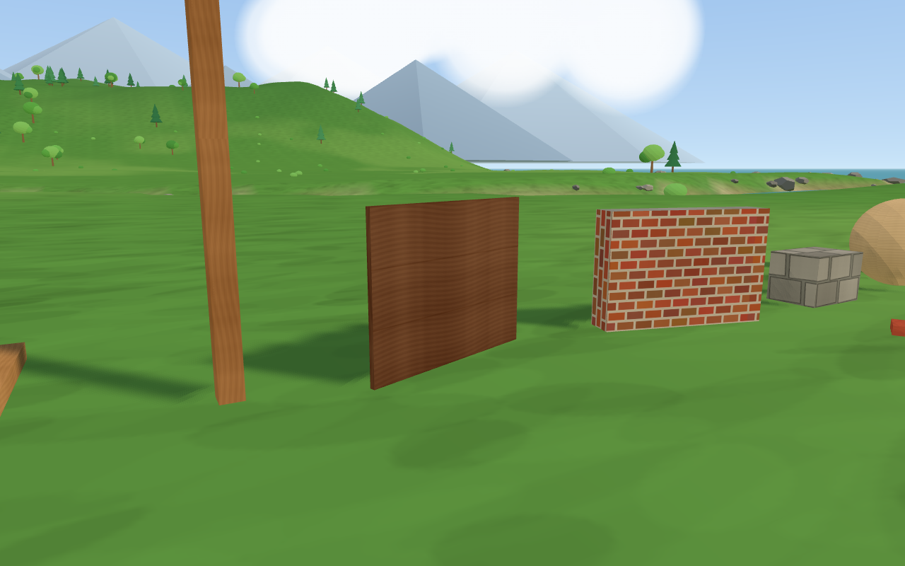
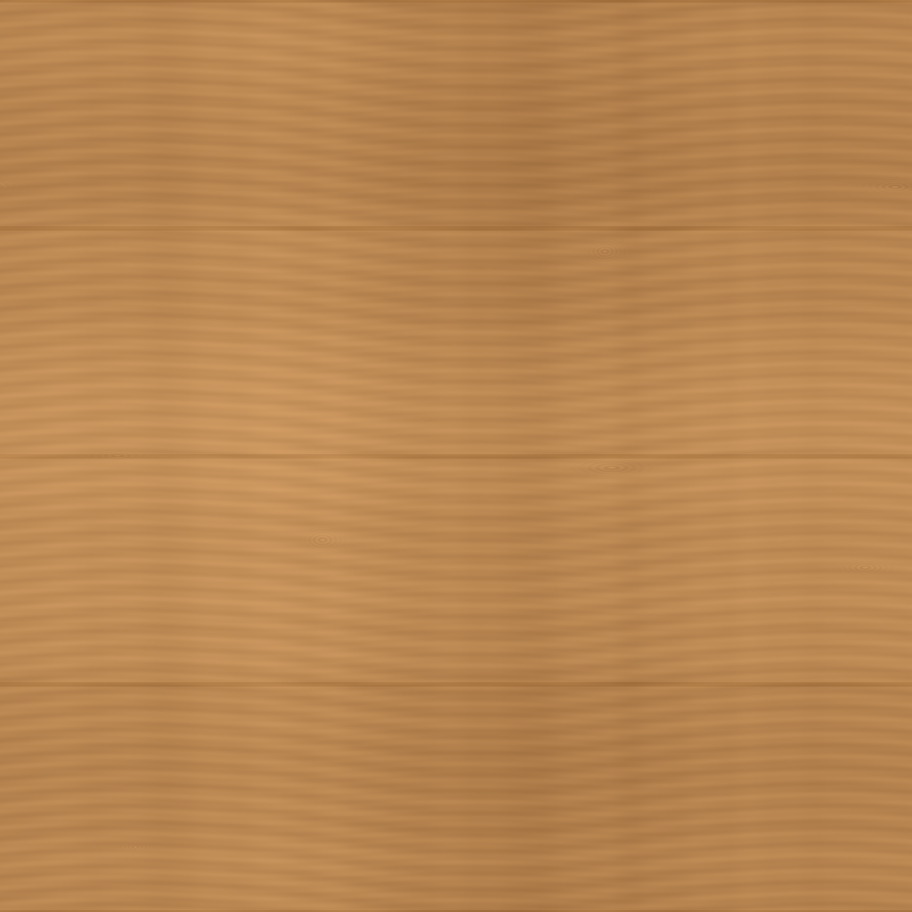
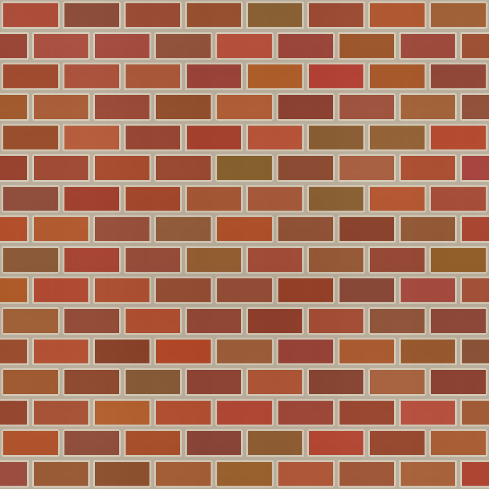

# WOODSCAPE — Đợt tạo ảnh số 1 (gửi ChatGPT)

Đợt này chỉ tạo **4 ảnh texture**: gỗ thông, gỗ sồi, gỗ óc chó, tường gạch đỏ.
Đây là 4 ảnh thay được nhiều thứ nhất trong game hiện tại. Chưa tạo cây, nhà, icon hay concept.

## Cách làm

1. Mở **một cuộc trò chuyện mới** với ChatGPT, dùng cuộc trò chuyện đó cho cả 4 ảnh.
2. Gửi **Tin nhắn 0** trước, đính kèm 3 ảnh trong thư mục `docs/chatgpt/images/`.
3. Gửi lần lượt Tin nhắn 1 → 4. **Mỗi tin nhắn chỉ xin 1 ảnh.** Ảnh chưa đạt thì dùng câu sửa ở cuối file, đừng viết lại prompt.
4. Tải ảnh về, đổi tên đúng như ghi ở từng mục, bỏ vào thư mục `art_inbox/` của dự án.
5. Báo Claude Code: "đã có ảnh trong art_inbox". Claude sẽ kiểm tra, sửa đường nối cho ảnh lặp liền mạch, rồi đưa vào game.

Ảnh ChatGPT tạo ra thường chưa lặp liền mạch 100% ở mép. Việc đó Claude xử lý sau, bạn không cần sửa.

## Ảnh đính kèm

| File | Dùng để làm gì |
|---|---|
| `images/ingame_wood.png` | Cho ChatGPT thấy texture sẽ nằm trên vật thể 3D nào trong game |
| `images/layout_wood.png` | Mẫu **bố cục** gỗ: vân chạy ngang, phủ kín khung, nhìn thẳng |
| `images/layout_brick.png` | Mẫu **bố cục** gạch: số hàng, cỡ viên, kiểu xếp so le |



| Bố cục gỗ | Bố cục gạch |
|---|---|
|  |  |

Hai ảnh bố cục là texture tạm đang dùng. Chỉ lấy bố cục, **không** lấy nét vẽ của chúng.

---

## Tin nhắn 0 — Thiết lập (đính kèm cả 3 ảnh)

```text
I am making a 3D building game called WOODSCAPE. I need flat material textures that
will be wrapped onto 3D boxes, beams and walls. I will ask for ONE image per message.
Do not generate anything yet; just confirm you understand the rules.

Attached images:
1. ingame_wood.png — a screenshot of the game. The textures go on objects like the
   wooden post, the dark wooden panel and the brick wall. This shows the usage only.
2. layout_wood.png — LAYOUT reference for wood: grain runs horizontally, the surface
   fills the whole frame, viewed straight-on. Copy the layout, NOT the look (it is a
   blurry placeholder).
3. layout_brick.png — LAYOUT reference for brick: brick size, number of rows and the
   staggered pattern. Copy the layout, NOT the look.

Rules for every image in this conversation:
- Art style: hand-painted background art from a bright Japanese slice-of-life anime.
  Visible soft brush strokes, gentle gradients, slightly simplified detail, warm and clean.
  Not photorealistic. Not a 3D render. Not pixel art. No thick black outlines.
- It is a flat material swatch, not a scene: straight-on orthographic view, no
  perspective, no camera angle, no depth of field.
- The material fills the entire image edge to edge. No border, no frame, no background,
  no objects, no tools, no hands.
- Lighting is flat and even. No cast shadows, no light direction, no vignette, no glare.
- Seamless and tileable: the left edge must match the right edge and the top edge must
  match the bottom edge. Avoid any unique feature that would look repeated when tiled.
- No text, no letters, no logo, no watermark, no signature.
- Square image, 1024 x 1024.
- All images must look like they were painted by the same artist with the same brushes.
```

---

## Tin nhắn 1 — Gỗ thông

Lưu thành: `art_inbox/wood_pine_albedo.png`

```text
Generate image 1: PINE WOOD texture, following all the rules above.

- Subject: the face of smooth planed pine timber.
- Color: light warm honey-yellow. Main tone around #E3B56F, lighter streaks around
  #F0CF94, darker grain lines around #C8924E. Keep contrast gentle.
- Grain: long, calm, slightly wavy lines running HORIZONTALLY across the whole image,
  like layout_wood.png. Lines are painted with soft brush strokes of varying width.
- Planks: one continuous wood surface. No gaps, no plank seams, no nails, no screws.
- Knots: none, or at most two very small soft ones.
- Nothing else in the image.
```

## Tin nhắn 2 — Gỗ sồi

Lưu thành: `art_inbox/wood_oak_albedo.png`

```text
Generate image 2: OAK WOOD texture. Same rules, same painting style, same brush work
and same grain scale as the pine image you just made. Only the wood species changes.

- Color: medium golden brown. Main tone around #A8733C, lighter streaks around #C39254,
  darker grain lines around #7E5226.
- Grain: horizontal, slightly denser and straighter than the pine, with a few short
  darker flecks typical of oak.
- One continuous surface, no plank seams, no knots, no nails.
```

## Tin nhắn 3 — Gỗ óc chó

Lưu thành: `art_inbox/wood_walnut_albedo.png`

```text
Generate image 3: WALNUT WOOD texture. Same rules, same painting style, same brush work
and same grain scale as the pine and oak images. Only the wood species changes.

- Color: dark chocolate brown, still warm and readable, not black. Main tone around
  #6B4226, lighter streaks around #8A5A36, darker grain lines around #4A2C18.
- Grain: horizontal, flowing, with gentle wide waves.
- One continuous surface, no plank seams, no knots, no nails.
```

## Tin nhắn 4 — Tường gạch đỏ

Lưu thành: `art_inbox/red_brick_albedo.png`

```text
Generate image 4: RED BRICK WALL texture. Same rules and same hand-painted anime
background style as the wood images.

- Layout: copy layout_brick.png. Horizontal rows of rectangular bricks in a staggered
  running-bond pattern, each row offset by half a brick. About 16 rows from top to
  bottom and about 4.5 bricks across. All rows perfectly horizontal, all bricks the
  same size.
- Bricks: warm terracotta red, main tone around #B8553A. Each brick varies slightly:
  some more orange (#C96A42), some darker (#964231). Soft painted texture on each
  brick, slightly rounded worn corners.
- Mortar: thin, even, light warm grey-beige lines around #D8CBB4.
- No moss, no cracks, no stains, no graffiti, no windows, no missing bricks.
- A brick cut by the left edge must continue on the right edge; the same for top and
  bottom.
```

---

## Câu sửa khi ảnh chưa đạt

Chỉ gửi đúng câu ứng với lỗi nhìn thấy:

| Lỗi | Câu gửi ChatGPT |
|---|---|
| Ảnh bị nghiêng, có phối cảnh | `Redo it as a perfectly flat straight-on swatch. No perspective at all.` |
| Có bóng đổ, chỗ sáng chỗ tối | `Redo it with completely flat, even lighting. No shadows, no highlights from a light source, no vignette.` |
| Trông như ảnh chụp thật | `Too realistic. Redo it as a hand-painted anime background texture with visible soft brush strokes and simpler detail.` |
| Có viền, khung, chữ, đồ vật | `Remove the border / text / objects. The material must fill the whole image and nothing else.` |
| Vân gỗ chạy dọc | `Rotate the grain so it runs horizontally, left to right.` |
| Gỗ có khe ván, đinh, mắt gỗ to | `Make it one continuous wood surface: no plank gaps, no nails, no large knots.` |
| Màu lệch | `Keep everything the same but shift the main color to #______.` |
| Nét vẽ khác hẳn các ảnh trước | `Match the painting style and brush work of the pine image exactly.` |
| Gạch quá to hoặc quá nhỏ | `Keep the style but use about 16 rows of bricks from top to bottom, like layout_brick.png.` |

## Tự kiểm tra trước khi lưu

- [ ] Ảnh vuông, vật liệu phủ kín, không viền, không chữ.
- [ ] Nhìn thẳng, không bóng đổ.
- [ ] Vân gỗ chạy ngang.
- [ ] Bốn ảnh đặt cạnh nhau trông như cùng một người vẽ.
- [ ] Đúng tên file, nằm trong `art_inbox/`.
