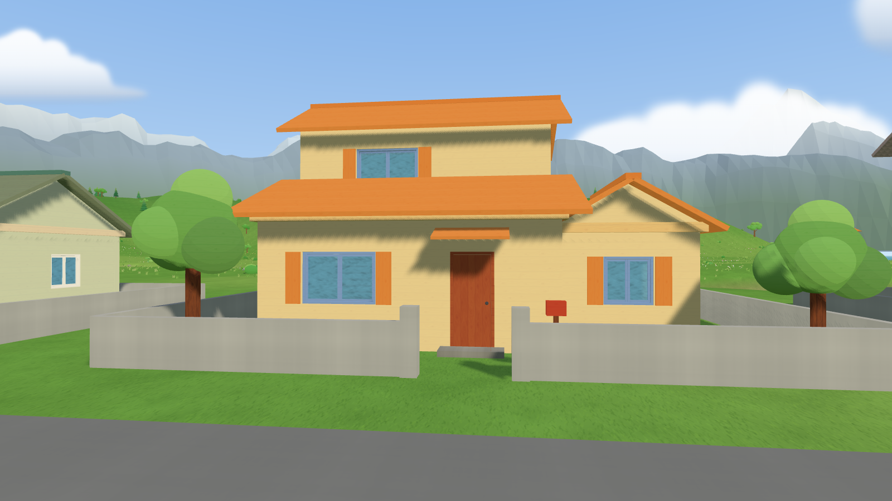

# WOODSCAPE — Đợt tạo ảnh số 2 (gửi ChatGPT): người, con vật, ngói

Đợt này tạo **5 ảnh**: 1 texture ngói và 4 tấm hình tham chiếu tỉ lệ (người đứng, người ngồi, mèo, chó).

Trong game, người và con vật là **tấm hình 2D dựng đứng** đặt trong cảnh 3D để so kích thước (cửa cao bao nhiêu, ổ mèo rộng bao nhiêu). Vì vậy mỗi nhân vật phải là **một hình duy nhất, nhìn thẳng, đủ toàn thân, nền một màu** để tách nền được.

## Cách làm

1. Dùng lại cuộc trò chuyện của đợt 1 nếu còn, để giữ nét vẽ. Nếu mở cuộc mới, đính kèm `images/ingame_house.png` ở tin nhắn đầu.
2. Gửi Tin nhắn 0, rồi từng tin nhắn 1 → 5. **Mỗi tin một ảnh.**
3. Lưu ảnh vào `art_inbox/` đúng tên ghi ở từng mục, rồi báo Claude Code.



---

## Tin nhắn 0 — Thiết lập

```text
I am making a 3D building game called WOODSCAPE, in a bright hand-painted Japanese
slice-of-life anime background style. The attached screenshot shows the current look:
cream walls, orange roofs, blue window frames, soft colors, no black outlines.

I need two kinds of images. I will ask for ONE image per message. Do not generate
anything yet; just confirm you understand.

A) A seamless material texture (same rules as before: flat, straight-on, no shadows,
   fills the frame, tileable, no text).

B) Scale reference cut-outs: a single character or animal that will stand in the 3D
   world as a flat upright card, so players can compare sizes. Rules for these:
   - Exactly ONE subject per image, whole body visible from head to feet, nothing cropped.
   - Viewed straight from the side or front at eye level. No perspective, no tilt.
   - Standing on nothing: no ground, no shadow on the floor, no background scenery.
   - Background: one flat solid color, pure magenta #FF00FF, edge to edge, so it can be
     removed. The subject must not contain magenta or pink.
   - Style: soft hand-painted anime look, simple shapes, gentle shading, clean edges.
     A thin dark-brown contour is fine; no thick black outline.
   - Original, generic design. Not a character from any existing anime, manga, game
     or film. No logos, no text.
   - Portrait image, 1024 x 1536, subject centered, small even margin all around.
```

---

## Tin nhắn 1 — Ngói đất nung (texture)

Lưu thành: `art_inbox/roof_terracotta_albedo.png`

```text
Generate image 1 (type A, texture): TERRACOTTA ROOF TILES.

- Rows of overlapping rounded clay roof tiles seen straight-on, as if looking at the
  roof surface from directly in front of it.
- About 10 horizontal rows from top to bottom, about 8 tiles across, every row offset
  by half a tile. All rows perfectly horizontal, all tiles the same size.
- Color: warm orange terracotta, main tone around #E08A3C, lighter tiles around #EFA45A,
  darker ones around #C56F2C. A soft darker line where each row overlaps the next.
- Flat even lighting. No moss, no broken tiles, no gutters, no sky.
- Seamless on all four edges. Square, 1024 x 1024.
```

## Tin nhắn 2 — Người đứng

Lưu thành: `art_inbox/ref_person_standing.png` · Chiều cao trong game: **1,70 m**

```text
Generate image 2 (type B, cut-out): ADULT PERSON STANDING.

- A friendly adult in plain everyday clothes: light shirt, simple trousers, flat shoes.
  Neutral colors (cream, soft blue, grey-brown).
- Front view, standing straight, arms relaxed at the sides, feet together, calm face.
- Realistic human proportions (about 7.5 heads tall), not chibi.
- Whole body from the top of the head to the soles of the shoes.
- Solid magenta #FF00FF background.
```

## Tin nhắn 3 — Người ngồi

Lưu thành: `art_inbox/ref_person_sitting.png` · Chiều cao trong game: **1,30 m**

```text
Generate image 3 (type B, cut-out): THE SAME PERSON, SITTING.

- Same person, same clothes and same painting style as image 2.
- Side view, sitting upright as if on a chair, but draw NO chair: thighs horizontal,
  lower legs vertical, feet flat, hands resting on the knees.
- Whole body visible. Solid magenta #FF00FF background.
```

## Tin nhắn 4 — Mèo

Lưu thành: `art_inbox/ref_cat_standing.png` · Chiều dài trong game: **0,46 m** không tính đuôi

```text
Generate image 4 (type B, cut-out): HOUSE CAT STANDING.

- An ordinary adult domestic short-hair cat, orange tabby with a cream chest.
- Exact side view, standing on all four legs, head facing right, tail raised in a
  relaxed curve. All four paws visible and level.
- Natural cat proportions, friendly face, not a cartoon mascot.
- Landscape image this time: 1536 x 1024. Solid magenta #FF00FF background.
```

## Tin nhắn 5 — Chó

Lưu thành: `art_inbox/ref_dog_standing.png` · Chiều cao vai trong game: **0,55 m**

```text
Generate image 5 (type B, cut-out): MEDIUM DOG STANDING.

- A medium-sized mixed-breed dog with a short golden-tan coat and floppy ears.
- Exact side view, standing on all four legs, head facing right, tail relaxed.
  All four paws visible and level.
- Same painting style as the cat. Natural proportions, friendly expression.
- Landscape image: 1536 x 1024. Solid magenta #FF00FF background.
```

---

## Câu sửa khi ảnh chưa đạt

| Lỗi | Câu gửi ChatGPT |
|---|---|
| Có mặt đất, bóng đổ, cảnh nền | `Remove the ground, the shadow and all scenery. Only the subject on flat magenta #FF00FF.` |
| Bị cắt mất chân, đầu hoặc đuôi | `Show the whole body with a margin around it. Nothing may touch the image edge.` |
| Nhìn chéo, có phối cảnh | `Redo it as an exact flat side view (or front view) at eye level, no perspective.` |
| Nền không đều màu | `Make the background one perfectly flat color, #FF00FF, with no gradient or texture.` |
| Giống nhân vật có sẵn | `Make it a generic original design, not resembling any existing character.` |
| Kiểu chibi, đầu to | `Use natural realistic body proportions, not chibi.` |
| Nét vẽ khác các ảnh trước | `Match the soft hand-painted style of the earlier images.` |
| Ngói bị nghiêng hoặc có bóng | `Redo the tiles perfectly flat and straight-on, rows exactly horizontal, even lighting.` |

## Tự kiểm tra trước khi lưu

- [ ] Mỗi ảnh chỉ một nhân vật / con vật, đủ toàn thân.
- [ ] Nền hồng cánh sen phẳng, không bóng, không mặt đất.
- [ ] Người đứng nhìn thẳng; người ngồi, mèo, chó nhìn ngang.
- [ ] Ngói phủ kín ảnh, hàng ngang thẳng.
- [ ] Đúng tên file, nằm trong `art_inbox/`.
